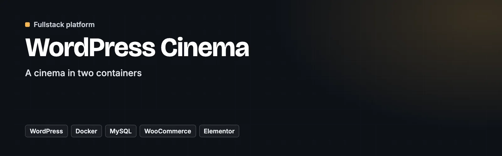

<p align="center">
  <a href="https://github.com/dawidolko/Wordpress-Cinema-Docker"></a>
</p>

# WordPress Cinema

> 🎟️ **A cinema in two containers** — WordPress and MySQL brought up by one command, with the theme and plugins versioned in the repository

**WordPress Cinema** is a cinema website built on WordPress and run in Docker. `docker compose up` starts WordPress on port 8080 and MySQL 8 beside it; `wp-content` is mounted from the repository, so the custom theme, the plugins and the uploads are version-controlled while the WordPress core stays where it belongs — inside the image.

The site itself covers what a cinema needs: a film slider, the repertoire, showtimes, trailers, sections for schools and family screenings, accounts and a ticket booking form, with WooCommerce available for selling seats.


[Getting started](#-getting-started)

---

## 🎯 Key Features

- **One command from nothing to a running site** — `start.sh` (or `start.bat`) checks that Docker is installed and running, then brings both containers up. No local PHP, no local MySQL, no XAMPP.
- **`wp-content` in git, core in the image** — the theme, the plugins and the uploads are tracked; WordPress itself is pulled from the official image, so an upgrade is a tag change rather than a merge.
- **A custom theme** — `cinema-house` sits alongside Astra and the default themes, so the cinema layout is the project's own rather than a settings screen on somebody else's theme.
- **Ticketing through WooCommerce** — WooCommerce with the Stripe checkout plugin, variation swatches and cart-abandonment recovery are part of the stack, so selling a seat is a configured path rather than a plan.
- **Trailers with a proper player** — Presto Player, rather than a raw YouTube embed per page.
- **Data survives restarts** — MySQL writes into a named volume, so `docker compose down` does not erase the site.
- **MySQL reachable from the host** — the database is published on 3307, so a GUI client can open it without entering the container.

---

## 🐳 The Stack

| Service     | Image             | Port          | Role                                          |
| ----------- | ----------------- | ------------- | --------------------------------------------- |
| `wordpress` | `wordpress:latest`| 8080 → 80     | The site; `wp-content` mounted from the repo.  |
| `db`        | `mysql:8.0`       | 3307 → 3306   | Database, persisted in the `db_data` volume.   |

---

## 🎨 What the Site Contains

**Homepage** — a film slider, cinema selection, the repertoire with showtimes, upcoming releases and an information footer.

**Navigation** — repertoire, trailers, family screenings, events and schools.

**Accounts** — registration and sign-in, with roles, plus a booking form for reserving seats.

---

## 🚀 Getting Started

### Prerequisites

- Docker and Docker Compose

### 1. Clone the repository

```bash
git clone https://github.com/dawidolko/Wordpress-Cinema-Docker.git
cd Wordpress-Cinema-Docker
```

### 2. Start it

```bash
./start.sh          # macOS / Linux
start.bat           # Windows

# or directly
docker compose up -d
```

### 3. Finish the WordPress installation

Open [http://localhost:8080](http://localhost:8080) and complete the installer once. The database credentials are already wired up by compose:

| Setting   | Value    |
| --------- | -------- |
| Database  | `wpdb`   |
| User      | `user`   |
| Password  | `password` |
| Host      | `db:3306` |

### 4. Activate the theme

In **Appearance → Themes**, switch to **Cinema House**.

### Stopping

```bash
docker compose down          # keeps the database
docker compose down -v       # removes it too
```

---

## 📁 Project Structure

```
Wordpress-Cinema-Docker/
├── docker-compose.yml       # wordpress + mysql, volumes and ports
├── start.sh / start.bat     # checks Docker, then brings the stack up
└── wp-content/              # the only WordPress directory kept in git
    ├── themes/
    │   ├── cinema-house/    # the custom cinema theme
    │   └── astra/ neve/ …   # fallbacks and defaults
    ├── plugins/             # WooCommerce, Stripe checkout, Elementor,
    │                        # Presto Player, variation swatches, cart recovery
    ├── uploads/             # media
    └── languages/
```

---

## ♿ Accessibility

An accessibility panel in the corner of every page changes text size, contrast, font and motion, and remembers the choice on the device. It sits on top of the markup and does not replace accessible markup.

---

## 📄 License

- The Docker setup (`docker-compose.yml`, `start.sh`, `start.bat`) is MIT © [Dawid Olko](https://dawidolko.pl).
- The WordPress themes and plugins in `wp-content/` are third-party software under GPL-2.0-or-later, and some themes declare a later GPL version. They keep their own copyright notices, see [LICENSE-GPL-2.0.txt](LICENSE-GPL-2.0.txt).
- Sample images in `wp-content/uploads/` come from the theme vendors' starter sites and stay under those vendors' terms.

---

## 👨‍💻 Author

**Dawid Olko** · Fullstack / AI Developer

[Portfolio](https://olkodawid.dawidolko.pl) · [CV](https://cv.dawidolko.pl) · [LinkedIn](https://www.linkedin.com/in/dawidolko/) · [GitHub](https://github.com/dawidolko)
